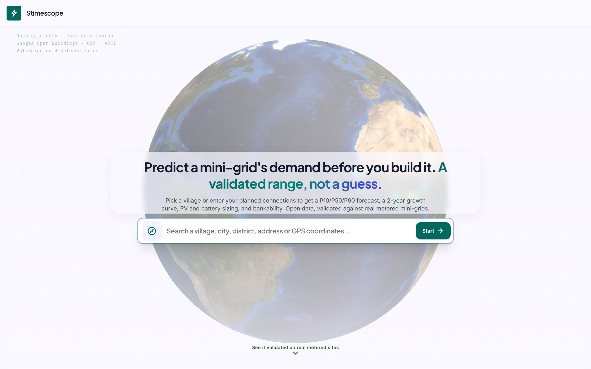
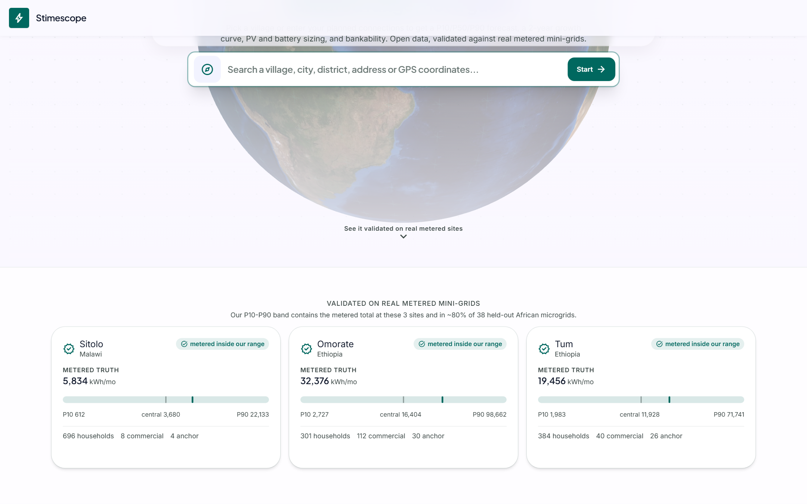
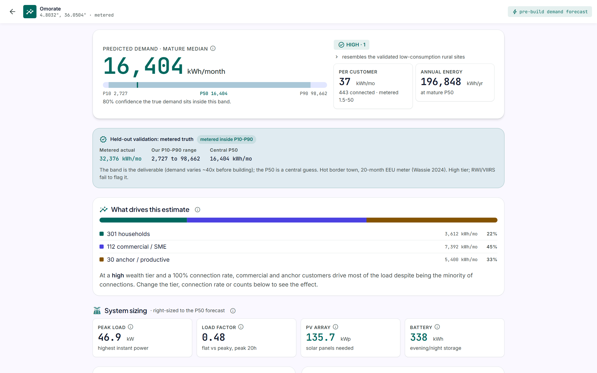
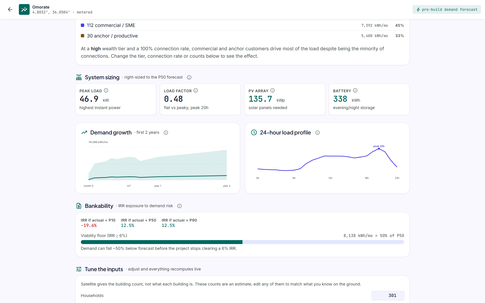

# Stimescope

Pre-connection electricity demand estimation for mini-grids.

Stimescope estimates the electricity demand of an unelectrified community
*before* a mini-grid is built - as a calibrated range (P10 / P50 / P90), not a
single number - together with a post-connection growth curve and a bankability
check. It runs on open public data alone, by outlining an area on a map.

**Live demo:** https://stimescope.shadrakbessanh.me

Built for the Global Energy Hackathon 2026, Problem Brief 03 -
"Predict mini-grid demand before building" (Digital Solutions & AI).

## Screenshots


*Outline a village on a map. Open data, validated on real metered sites.*


*The P10-P90 band contains the metered total at 3 named sites and in about 80% of 38 held-out African microgrids.*


*A result page: the demand range, the held-out validation, and what drives the estimate.*


*System sizing, the two-year growth curve, the 24-hour load profile, and the bankability check.*


## Why it matters

Developers size systems and raise financing from demand forecasts. Unelectrified
villages have no meter history, and surveys mislead because people cannot predict
use of electricity they have never had. Forecasts can be off several-fold, which
leads to oversized systems with unaffordable tariffs, undersized systems that
brown out, or projects that never get financed.

## Approach

A regression on existing consumption is the wrong tool here: the only open
household consumption data is from *grid-connected* homes, a different and much
higher-demand population than a new rural mini-grid serves. Stimescope instead
uses the sector-standard **bottom-up** method (e-GUIDE / VIDA):

1. **Count customers** from satellite building footprints (Google Open Buildings,
   with OSM as a fallback) within a radius of the site.
2. **Segment** them into households, commercial, and anchor (productive) loads.
3. **Apply per-customer demand medians** taken from *real metered* references
   (Blodgett Kenya mini-grids ~3.4, MDPI 2026 harmonized set, AMDA, A2EI telemetry).
4. **Aggregate deterministically**: the P50 is bottom-up (customers x metered
   per-customer medians x tier); the P10-P90 band is the measured cross-site demand
   spread (a lognormal sigma calibrated on 38 metered microgrids, ~80% held-out
   coverage). No random draws: identical inputs give identical outputs.
5. **Project the growth curve** derived from real A2EI smart-meter telemetry and
   the Wassie metered trajectory (demand roughly triples over the first ~5 months,
   then grows ~30%/yr through year 2).
6. **Check bankability**: map the demand range to project IRR (CrossBoundary
   sensitivity) and report how far below forecast demand can fall before the
   project stops clearing a viable IRR.

## Validation

Benchmarks are recalibrated to metered reality (household median ~4 kWh/month,
Blodgett ~3.4 and the MDPI 2026 harmonized set), and the P10-P90 band is the
measured cross-site spread. Held-out metered total falls inside the band at the 3
named sites and in ~80% of 38 representative African microgrids. The P50 is a
central guess only (demand varies ~40x before connection); the band is the output.

## Reproduce

The engine is deterministic and needs no external data. From a clean clone:

```
pip install -e .
python scripts/validate_sites.py     # held-out metered validation (below)
python scripts/run_estimate.py       # demand + growth for a sample site
```

`validate_sites.py` prints, identically on every run and machine:

```
site                   tier        RWI   metered  P50 tier  err def  err tier  in-band
Sitolo (Malawi)        typical   -0.32     5,834     3,680     -37%      -37%  True
Omorate (Ethiopia)     high      -0.40    32,376    16,404     -72%      -49%  True
Tum (Ethiopia)         high      -0.32    19,456    11,928     -64%      -39%  True
...
Held-out coverage on 38 metered African microgrids: 30/38 = 79% inside P10-P90.
```

The metered totals fall inside the predicted P10-P90 band. The RWI
column and the A2EI benchmark line use datasets that are not bundled (see
`data/README.md`); when absent the script falls back to the published values so
the core validation still runs with zero downloads.

## Frontend

`gridcast.engine.js` is a byte-faithful JavaScript port of the Python engine; it
runs the whole demand pipeline offline in the browser. A cross-check of the two
engines on 4 sites and 92 numeric fields shows 0 difference. The web app
(`code.html`) calls a small FastAPI service only for the satellite building count
(the Open Buildings tiles are too large for a browser); all demand math is client
side.

Run the app offline (no server, demo + custom sites, full engine):

```
python -m http.server 8000 --directory web   # then open http://localhost:8000/code.html
```

Live satellite counts additionally need the count service:

```
pip install fastapi uvicorn
GRIDCAST_HOME=/path/with/tiles uvicorn server.gridcast_api:app --port 8611
```

The Open Buildings tiles it indexes are public (CC-BY, storage.googleapis.com/
open-buildings-data) and downloaded on demand per country.

## Brief deliverables

| Deliverable | Where |
| --- | --- |
| Demand estimate with a range for any location | web app + `src/gridcast/estimate.py` |
| Demand growth curve for the first years | `src/gridcast/growth.py`, `growth_curve.csv` |
| Validation against held-out metered sites | `scripts/validate_sites.py` (3 named + 38 MDPI) |
| Plain-language driver explanation for lenders | results page "What drives this estimate" + info tooltips |
| Proposal for safe operator data sharing | submission one-pager / deck |

## Layout

- `src/gridcast/` - package source (benchmarks, estimate, growth, loadprofile,
  sizing, bankability, confidence, geo, open_buildings, wealth) + `growth_curve.csv`
- `scripts/` - command-line entry points, incl. `validate_sites.py`
- `web/` - offline web app + JavaScript engine; `server/` - count service
- `data/` - datasets (not committed; see `data/README.md`)

## Status

Global Energy Hackathon 2026 sprint.
